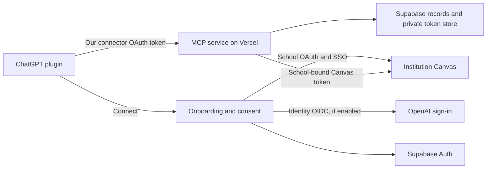

# Canvas CLI → ChatGPT plugin plan

Research date: October 1, 2026. The user subsequently approved implementation and changed school authentication to personal access tokens for the private pilot. See [implementation status](implementation-status.md) for the executed architecture, resources, tests and remaining activation dependencies. The original OAuth/public-launch research below remains reference material, not a claim about the current implementation.

## Decision

The repository can supply the Canvas client and student workflows for a hosted MCP plugin in ChatGPT. OpenAI now documents a universal plugin package for ChatGPT and Codex, optional MCP Apps UI, and **Sign in with ChatGPT**. The desired experience is technically supported, but public launch has three unresolved prerequisites:

1. **OpenAI access:** Sign in with ChatGPT for hosted websites/plugins is a limited trial for selected commercial partners. Request a provisioned client and plugin-modal enablement through an OpenAI representative. Availability is documented; access for this project is not verified. [Sign-in quickstart][siwc-quickstart] · [Plugin sign-in][siwc-plugin]
2. **Canvas authorization:** A multi-user application must use Canvas OAuth. Canvas expressly disallows asking other users to generate and paste personal tokens. Obtain an institution-issued developer key for the pilot, or pursue an Instructure global developer key; institutions still have to enable global keys. [Canvas OAuth][canvas-oauth] · [Developer keys][canvas-keys]
3. **Directory eligibility:** Current OpenAI guidelines prohibit plugins that primarily act as unofficial third-party connectors. Obtain the relevant Canvas authorization and clarify this product's eligibility with OpenAI. A useful study workflow or different branding alone does not establish approval. Personal/developer testing and public-directory publication are separate milestones. [Plugin guidelines][guidelines]

Recommended first release: a read-only course companion for one authorized institution, with school selection, connection status, courses, upcoming assignments, module navigation, and source-linked course content. Expand schools after the OAuth and approval path works.

## Repository fetched

- Remote: https://github.com/lukeguo12210/canvas-cli
- Local checkout: `/Users/lukeguo/github/canvas-cli`
- Branch: `main`
- Fetched commit: `afea336ac1700531a4ae38a218dbd071eadd9d86`
- Package: `@lukeguo12210/canvas-cli`, version `0.0.8`, TypeScript/ESM.
- Clean checkout verified immediately after cloning; this plan, the target manifest and the root agent instructions are new local, uncommitted files.

Useful existing pieces are `src/core/canvas-client.ts`, `src/registry/schools.ts`, course/module/page/assignment/file commands, and the seven existing Canvas skills. The current application uses a local PAT profile; its authentication and filesystem exports are not a hosted multi-user backend.

The current license identifies Luke Guo as licensor and uses BUSL-1.1. Preserve the license and review ownership/dependency rights when packaging the hosted product. Do not assume this source-available repository qualifies for OpenAI's separate open-source ChatGPT-plan-usage program.

## User journey

1. The user installs/connects the plugin in ChatGPT and chooses **Continue with ChatGPT**, once enabled by OpenAI.
2. Our service establishes an application identity and preserves the outer ChatGPT connector authorization transaction.
3. A short page on our domain asks the user to find their school. Results distinguish **Ready to connect** from **Not yet supported**. Existing school names/URLs seed a catalog; verify each hostname and OAuth enablement before marking it ready.
4. Selecting a supported school sends the user to that school's Canvas/SSO login and consent screen. School passwords and MFA remain on the school's site. We request the minimum approved read scopes.
5. The backend exchanges the Canvas code, records the institution and Canvas user identity, encrypts the access/refresh tokens, and confirms the connected school/account. No manual token field is offered to public users.
6. The user confirms the plugin's access, returns to ChatGPT, and can ask for courses, due dates, or course materials.
7. Settings allow reconnecting, switching schools, disconnecting a school, revoking plugin access, and deleting the application account. Unsupported schools have an explanatory state and optional request flow; a user-supplied URL does not authorize arbitrary backend fetching.

If partner sign-in access is unavailable, a real Supabase-supported sign-in method can support an authorized pilot. Keep it as a clearly identified fallback decision, not a fake ChatGPT login or a promise that the preferred flow already works. A pure MCP tool service does not need an extra paid LLM API just to answer inside ChatGPT.

## Architecture and authentication boundaries

Keep three transactions and credentials separate:

| Flow | Purpose | Credential boundary |
| --- | --- | --- |
| ChatGPT → our authorization server | Grant ChatGPT access to our MCP service | Our connector code, PKCE, access/refresh tokens, resource and permissions |
| Our app → OpenAI | Identify the user through Sign in with ChatGPT | Separate state, nonce, PKCE, callback and verified OpenAI ID token |
| Our app → institution Canvas | Authorize access to that user's school data | Institution-specific client key, state, callback and Canvas access/refresh tokens |

OpenAI's plugin guide explicitly separates the outer connector transaction from inner sign-in. Canvas authorization adds a third independent grant. Never substitute an OpenAI ID token or Canvas token for our connector credential. An email/login hint is not identity proof, and matching email addresses must not silently merge accounts. [Plugin sign-in][siwc-plugin] · [Website sign-in][siwc-website]

**Proposed stack:** Next.js App Router on Vercel's Node.js runtime, with Streamable HTTP MCP at `/mcp`; Supabase Postgres, Auth and private secrets storage. Use maintained MCP/OIDC libraries rather than inventing a token protocol. OpenAI documents the MCP auth contract, and Vercel documents `mcp-handler` hosting. [MCP auth][mcp-auth] · [Vercel MCP][vercel-mcp]

**Mandatory auth spike before committing to the stack:** Supabase documents an OAuth 2.1 server and custom OIDC providers, but its OAuth server is currently beta. Prove OpenAI's provisioned identity-only client works with Supabase's custom provider implementation, including its token-endpoint method and ID-token response without assuming an OpenAI access/refresh token. Prove the outer server supports the chosen ChatGPT client registration method, PKCE S256, exact callback, audience/resource binding, permissions, JWKS validation and revocation. Confirm how any `target_flow`/login hint reaches the consent UI. Use the exact production callback supplied by the OpenAI portal. Do not advertise CIMD or issuer-identification support unless implemented and tested. If there is a compatibility gap, resolve the auth provider/adapter design before building onboarding around it. [Supabase OAuth][supabase-oauth] · [Supabase MCP auth][supabase-mcp] · [Custom OIDC][supabase-custom] · [OAuth setup][supabase-oauth-setup]

## Credentials and data

Store **OAuth credentials on the backend**, not school passwords. Suggested records:

- Application user and verified external identity mapping, using issuer/client/subject rather than email as the unique identity.
- Institution catalog: canonical Canvas origin, verified status, OAuth enablement, approved scopes and a reference to the institution's client secret.
- Canvas connection: application user, institution, Canvas user ID, grant/scopes, expiry, encrypted secret references and revocation state. Identity is the institution plus Canvas user ID, not Canvas user ID alone.
- Short-lived login/authorization transactions and consent records. Consume states/codes atomically across Vercel instances; do not rely on process memory.
- Minimal operational audit data, with a documented purpose and retention. No content bodies, bearer tokens, cookies, OAuth codes or signed file links in logs.

Use Supabase Vault as a candidate encrypted credential store. Access to its decrypted view must be tightly restricted; encryption does not make an exposed SQL view safe. No browser, anonymous role, user JWT or model tool can read token material. Use a narrowly privileged server path with explicit ownership checks, since privileged database access can bypass RLS. Keep deployment/bootstrap secrets in the selected project's server-only environment settings. [Supabase Vault][supabase-vault]

Default MVP content policy: fetch course data on demand and avoid long-term copies of files or complete courses. If caching is needed, key it by application user, institution and connection and define a short retention period. Disconnect must invalidate our grants and caches, revoke upstream access where supported, and delete stored credentials. Account deletion and backup-retention behavior must be explained in the privacy policy. These are proposed product requirements, not a completed legal/compliance review.

## Source adaptation and hosted hardening

1. Extract/import a request-scoped Canvas service from the existing TypeScript client. Preserve the CLI adapter; never run a shared `canvas auth login` or load a developer's global config on the server.
2. Bind the Canvas client to the authenticated user's connection on every call. The model must not supply a user ID, bearer token, arbitrary base URL or local output directory.
3. Harden pagination: current `get()` follows the `Link` header's next URL and attaches the bearer token without checking the next origin. Require the approved Canvas origin and expected API path on every page and redirect.
4. Harden downloads: current `download(url)` attaches the Canvas bearer to its input URL. Resolve files through authenticated Canvas metadata; never forward that bearer to another origin. Validate every redirect, DNS/IP destination and HTTPS URL. Block private/link-local destinations, credential-bearing URLs, oversized responses and unbounded downloads. Use deliberate handling for legitimate Canvas file hosts/CDNs.
5. Enforce timeouts, pagination/byte limits, cancellation, per-user/per-school concurrency and rate-limit backoff. Refresh Canvas tokens under a per-connection lock to avoid concurrent refresh races.
6. Sanitize rendered Canvas HTML and treat course/file contents as untrusted data. Return canonical Canvas source links so users can verify answers. Make permission failures distinct from expired connections.
7. Curate each MCP tool separately. Do not expose the CLI's generic raw GET or a shell/command executor as a public tool.
8. Rewrite selected bundled skills to describe hosted tools and OAuth onboarding. Do not package existing PAT-paste/local-config instructions as public onboarding.

These are implementation requirements identified from the fetched source, not fixes made in this planning stage.

## MVP tool and UI scope

Initial independently callable tools: `list_courses`, `get_course_overview`, `list_assignments`, `get_assignment`, `list_modules`, `get_module_items`, `get_page`, and `get_file_metadata`. Add a bounded file-content tool only after download authorization, size limits and file handling are validated. A course/assignment list widget can provide source links and account context; keep authentication on our HTTPS pages and institution pages.

Return only task-relevant data. Avoid forwarding the CLI's full debug envelope into model results. For reads confined to the user's approved Canvas account, proposed annotations are `readOnlyHint: true`, `destructiveHint: false`, `openWorldHint: false`; re-evaluate each tool's actual behavior. Creating/storing review packs or starting export jobs is a write even when Canvas itself is only read. [Plugin guidelines][guidelines]

Defer grades, private messages, submissions, roster-wide data, posting, assignment submission, and bulk course exports. Later review-pack work can use private Supabase Storage, expiry-controlled links, a job table and a worker/durable workflow if execution duration requires it. Do not add Redis, Blob, Queues, AI Gateway or a second database before a concrete need is established.

## Account isolation: required before kickoff mutations

The user's explicit constraint is **no aident.ai work resources or billing**. A different project name under the work team is insufficient.

Read-only checks after the user completed connection setup verified these targets under Loadout `lukeguo12210@gmail.com`:

| Surface | Observed state | Decision |
| --- | --- | --- |
| Loadout Vercel `Personal` | `Luke Guo's projects`, slug `luke-guos-projects`, ID `team_tRdTZetEMtiIbrCXFDOq8itX`; provider read succeeded | Intended personal target |
| Loadout Supabase `Account 1` | `Luke's Org`, ID/slug `picznioxscdeujoelrwv`; provider read succeeded | Intended personal target |
| Loadout Vercel `Aident Team Work` | Original work connection preserved separately; `aident-ai-team`, ID `team_T4pO4xEDqlGcrDBDyLUbNHbk` | Prohibited for this project |
| Local Supabase CLI, earlier check | `Aident AI`, ID `ugsvddbslvkdvzihgsoy`; also `Open CUA` | Neither is the selected target; do not use ambient local credentials |

Both Vault connections report ready, and explicit-alias action execution returned the personal team/organization above. The initial browser/CLI Loadout login mismatch is resolved for these connections. Keep using explicit aliases even though Personal is now Vercel's default. The exact non-secret allowlist is saved in `docs/deployment-targets.json`; project IDs/refs are unassigned. This is verified account selection, not provisioning or deployment authorization.

At kickoff:

1. Refresh Vault status and list provider identity/team/organization metadata under the recorded aliases. An alias is not proof of which provider account it currently uses.
2. Match the returned Vercel team and Supabase organization against the recorded exact IDs. An absent or ambiguous target blocks cloud mutations. Do not switch or overwrite global work CLI credentials.
3. Use the project-specific allowlist and work denylist in `docs/deployment-targets.json`. Before any create/link/env-write/migration/deploy, verify the selected identity, parent team/org, project ID/ref and billing owner. Implement a fail-closed preflight in both local commands and CI; the manifest and root `AGENTS.md` are not yet executable enforcement.
4. Prefer Loadout execution with explicit `accountAlias`. If a local CLI is required, use isolated project credentials/configuration, explicit Vercel scope/team and explicit Supabase project ref. Verify `.vercel/project.json`, any Supabase link file and environment provenance before use; do not copy `.env` or linkage from aident.ai.
5. Create separate development and production projects under the verified personal organizations. Keep personal GitHub deployment connections, CI secrets and approved OpenAI publishing identity separate from work resources.
6. After each provisioning/deployment operation, read back the resulting owner and project/ref; record only non-secret evidence.

The user connected the personal accounts for this project, and the provider reads verified the intended organizations. The remaining ownership work is to create and record project IDs only when implementation/provisioning is authorized. Continue to stop cloud mutations on any target mismatch.

The installed Vercel CLI is `58.7.1`; upgrade to the current release before implementation (`npm i -g vercel@latest` or `pnpm add -g vercel@latest`). It was not changed during this task. Live Marketplace discovery confirmed Supabase in both storage and authentication. Install/link that integration only after the account checks pass; choose/create the database in the verified Supabase organization rather than accepting a work default.

## Implementation milestones and acceptance criteria

| Milestone | Work | Evidence required to proceed |
| --- | --- | --- |
| 0. Access and ownership | Verify personal cloud targets; obtain pilot Canvas developer key; clarify public listing authorization; request OpenAI sign-in trial | Exact approved account IDs, documented pilot authorization, known sign-in availability and distribution route |
| 1. Auth vertical slice | Provision isolated development resources; prove Supabase/OpenAI compatibility; complete three separate grants; secure token storage and disconnect | A real authorized test user connects from ChatGPT, reads their own course, refreshes and revokes; second user cannot access the first user's data |
| 2. Read-only product | Reuse client, implement hardening, school catalog, typed tools and compact UI | Representative courses/assignments/pages work with source links, bounded output and predictable errors |
| 3. Qualification | Test OAuth attacks/account switches, tenant boundaries, redirects/downloads, rate limits, revocation and mobile UI | Automated security/contract tests plus real ChatGPT developer-mode end-to-end evidence |
| 4. Package and review | Package remote MCP and curated skills; verified publisher/domain; privacy/terms/support; demo account and review materials | Package validates, tool scan passes, five positive and three negative cases run on reviewer-ready sample data; review submission ready |
| 5. Publish | Submit approved materials, address review, then publish when authorized | Actual review/publish state verified; no claim that package creation or upload equals approval |

The public package should use the currently documented portable `plugin.json`/`mcp.json` structure, with OpenAI-specific metadata under `extensions.com.openai`, selected `skills/` and assets. Include the remote MCP in the initial package. Revalidate the submission schema at build time; hosted URLs must be durable, and secrets/reviewer credentials stay outside the ZIP. [Package guide][package] · [Submission guide][submission]

Qualification should include denied/replayed/expired state and codes; wrong token issuer/audience/nonce; mixed OpenAI/connector/Canvas transactions; switched users; wrong institution; missing scopes; disabled developer keys; concurrent refresh; RLS and secret-store isolation; arbitrary URL/redirect/SSRF attempts; cross-origin token leakage; prompt injection in course content; large files; 429/5xx; revocation and deletion. No real student's private coursework should serve as reviewer sample data.

## Official resources

- [Plugins overview][plugins] — ChatGPT/Codex distribution model.
- [Sign in with ChatGPT quickstart][siwc-quickstart], [plugin flow][siwc-plugin], and [website flow][siwc-website] — availability, identity and connector separation.
- [MCP authentication][mcp-auth], [plugin guidelines][guidelines], [packaging][package], and [submission][submission] — protocol and public-review requirements.
- [Canvas OAuth][canvas-oauth] and [developer keys][canvas-keys] — institution access, tokens, refresh and scope controls.
- [Supabase OAuth server][supabase-oauth], [setup][supabase-oauth-setup], [MCP authentication][supabase-mcp], [custom OIDC][supabase-custom], and [Vault][supabase-vault] — candidate identity and storage primitives.
- [Vercel MCP hosting][vercel-mcp] and [Next.js MCP example][vercel-template] — hosting starting points. Treat example token checks as demonstrations; use actual JWT verification.

[plugins]: https://developers.openai.com/plugins
[siwc-quickstart]: https://developers.openai.com/siwc/quickstart
[siwc-plugin]: https://developers.openai.com/siwc/chatgpt-plugin
[siwc-website]: https://developers.openai.com/siwc/website
[mcp-auth]: https://developers.openai.com/plugins/build/auth
[guidelines]: https://developers.openai.com/plugins/plugin-guidelines
[package]: https://developers.openai.com/plugins/build/plugins
[submission]: https://developers.openai.com/apps-sdk/deploy/submission
[canvas-oauth]: https://developerdocs.instructure.com/services/canvas/oauth2/file.oauth
[canvas-keys]: https://developerdocs.instructure.com/services/canvas/oauth2/file.developer_keys
[supabase-oauth]: https://supabase.com/docs/guides/auth/oauth-server
[supabase-oauth-setup]: https://supabase.com/docs/guides/auth/oauth-server/getting-started
[supabase-mcp]: https://supabase.com/docs/guides/auth/oauth-server/mcp-authentication
[supabase-custom]: https://supabase.com/docs/guides/auth/custom-oauth-providers
[supabase-vault]: https://supabase.com/docs/guides/database/vault
[vercel-mcp]: https://vercel.com/docs/mcp/deploy-mcp-servers-to-vercel
[vercel-template]: https://vercel.com/templates/ai/model-context-protocol-mcp-with-next-js
